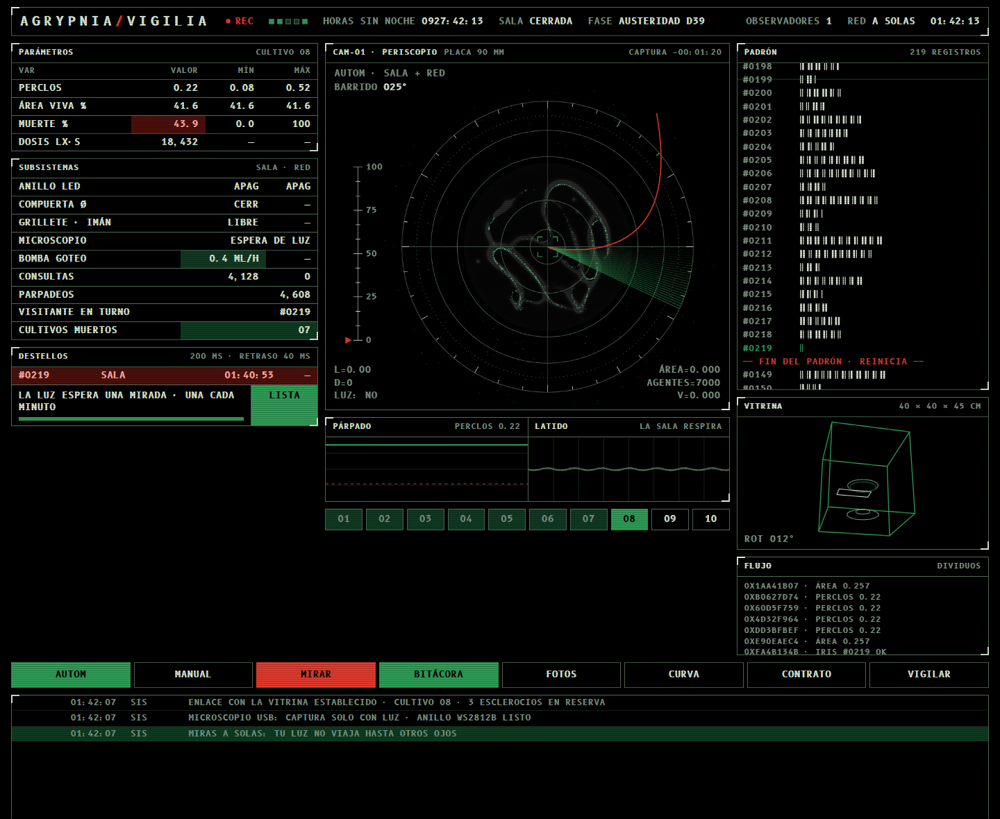

# AGRYPNIA · Vigilia 24/7

Vigilia y castigo sobre un cultivo de *Physarum polycephalum*. Prototipo especulativo de bioarte (AT5006).

- **Interfaz web** (`index.html`): la vigilia transmitida por la red. Mirar despierta la webcam sobre la placa de Petri, enciende la luz 200 ms sobre un organismo que la rehúye y deja una huella en el padrón.
- **Realidad aumentada** (`ra/`): la instalación, la estación, el brazalete y el corte de la vitrina a escala real (`.glb` para Android, `.usdz` para iPhone y iPad).



## Cómo subirlo a GitHub Pages (sin instalar nada)

1. En github.com, crea un repositorio **público** (por ejemplo `agrypnia`). No hace falta README, porque ya viene incluido.
2. En el repositorio vacío, entra a **Add file → Upload files** (o «uploading an existing file»).
3. Arrastra **todo el contenido** de esta carpeta: `index.html`, `README.md` y las carpetas `ra` y `capturas`. Arrastra las carpetas completas para que se conserve su estructura.
4. Escribe un mensaje (por ejemplo «sitio AGRYPNIA») y pulsa **Commit changes**.
5. Ve a **Settings → Pages**. En *Build and deployment* elige **Deploy from a branch**, la rama **main** y la carpeta **/ (root)**, y pulsa **Save**.
6. Al cabo de uno o dos minutos, el sitio queda en:
   - Interfaz: `https://TU-USUARIO.github.io/agrypnia/`
   - Realidad aumentada: `https://TU-USUARIO.github.io/agrypnia/ra/`

Ningún archivo supera los 25 MB, que es el límite al subir desde la web de GitHub. En total son unos 35 MB.

## Qué funciona en GitHub Pages
- **Toda la interfaz:** simulación del Physarum, cámara, luz, bitácora, padrón, vitrina, curva y sonido (el sonido empieza con el primer clic). Cada visitante mira **a solas**: no hay galería compartida ni límite común de un destello por minuto, porque eso necesita una base de datos.
- **La realidad aumentada:** GitHub Pages sirve el sitio por https y con el tipo correcto para `.glb` y `.usdz`, que es lo que exigen Scene Viewer (Android) y AR Quick Look (iOS). Abre `/ra/` en el teléfono y toca «Ver en tu espacio».
- **Lo externo:** la tipografía B612 Mono (Google Fonts) y el visor `<model-viewer>` (unpkg) se cargan de fuera.

## Estructura
```
index.html              interfaz de la vigilia
ra/index.html           visor de realidad aumentada
ra/glb/*.glb            modelos para Android y la web
ra/usdz/*.usdz          modelos para iPhone y iPad
capturas/               imágenes para este README
```

## Créditos
Modelos y texturas de [Poly Haven](https://polyhaven.com) y [ambientCG](https://ambientcg.com) (CC0). Interfaz y modelos de AGRYPNIA construidos en TouchDesigner.
